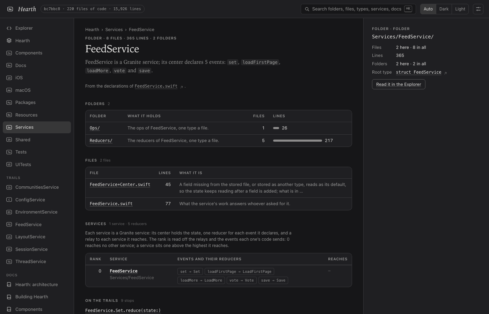

# Testing DocumentationAgent

## Conformance on Hearth

Level 1 of the regime: the call a model should write, sent straight to the installed runner over its wire
(granite-agent/1) with no model, on a copy of Hearth as the journey left it (services, mock data and loom's views
made), then checked by building, testing and screenshotting the app. A pass here means the agent can produce the
result deterministically; whether Craft's model writes this call is tested by the prompts above.

### Hearth's Markdown, site and README

*2026-11-01 · straight to the runner, no model*

**The call**:

```json
{
  "make": "site"
}
```

**Checks**:
- markdown: 11 pages; site: 17 files that open from file://; readme: 2 files. With no model, the prose is left out and the answer says so


*The site's FeedService page: its folders, files, events and reducers*
